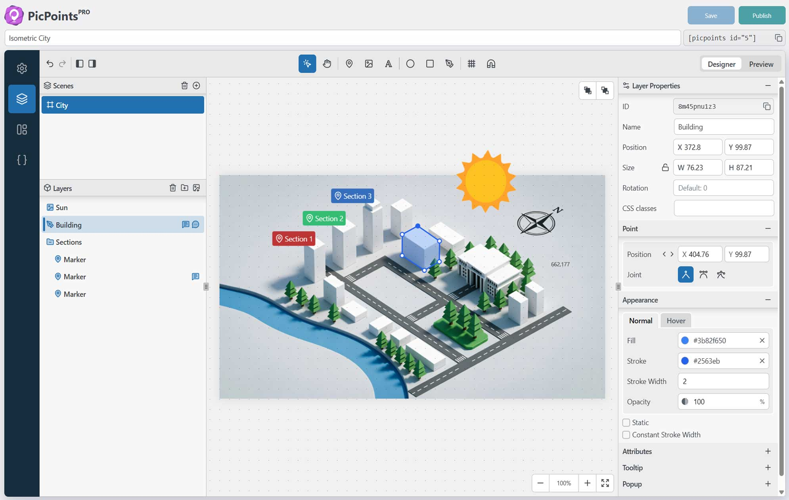

# PicPoints - Interactive Image Map & Hotspot Builder

Create high-performance interactive image maps, floor plans, and online
soundboards in minutes with a feature-rich, React-powered SVG builder.

## About this repository

This repository contains the **exact free version published on [WordPress.org](https://wordpress.org/plugins/picpoints/)** - the JS and CSS assets here are intentionally **not minified or obfuscated**, so you can read
and audit every line the plugin runs on your site. The Pro version is distributed separately via [yalogica.com](https://yalogica.com/picpoints/).

## Description

PicPoints is a WordPress plugin for building interactive image maps, clickable floor plans, shoppable lookbooks, and audio soundboards - no coding required.
It runs on a modern React + Shadow DOM architecture: blazing-fast loading, smooth instant editing, and zero CSS conflicts with your theme. The pro-grade SVG vector editor draws rectangles, ellipses, markers, and custom polygons with smooth Bezier curves, handling hundreds of interactive elements without slowing down your website.

- [Live Demos](https://yalogica.com/picpoints/showcases/)
- [Documentation](https://yalogica.com/docs/picpoints/)
- [Upgrade to Pro](https://yalogica.com/picpoints/)

### Free version highlights

- Unlimited maps, up to 3 scenes (levels) and 10 layers/markers per scene
- SVG layers: rectangles, ellipses, images, text, and polygons
- Markers (icon + text or image) with custom anchor point positioning
- Audio hotspots for building online soundboards and audio guides
- Smart undo/redo history, touch gestures, and pinch multi-touch zooming
- Tooltips and rich-content popups, strict pan & zoom behavior
- Custom viewport & scene background (color or image)
- Widgets: scene title, navigation dots & switcher, fullscreen toggle,
  fit-to-screen, zoom controls

**PicPoints Pro** adds unlimited scenes and layers, SVG import from Illustrator or Inkscape, Handlebars templates, custom JS & CSS sections, and a developer API for professional agencies and growing businesses.

## Installation

The canonical, always-up-to-date build lives in the WordPress.org directory:

1. In your WordPress admin, go to **Plugins → Add New**.
2. Search for "PicPoints".
3. Click **Install Now**, then **Activate**.

Or download the installable zip directly from
[wordpress.org/plugins/picpoints](https://wordpress.org/plugins/picpoints/).

## Support

- **Usage & installation help:** use the [WordPress.org support forum](https://wordpress.org/support/plugin/picpoints/) - this is the fastest way to get an answer.
- **GitHub Issues:** for reproducible bugs in the source code published in this repository only.

